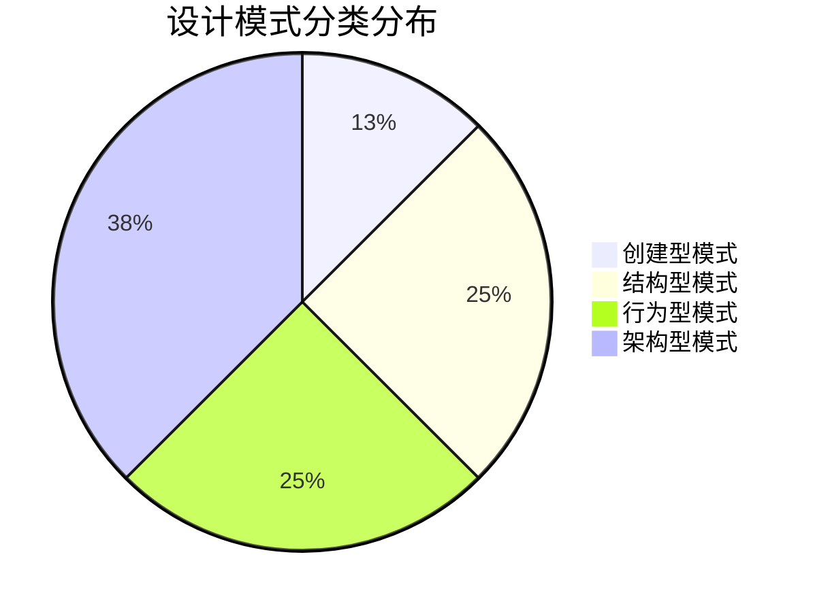

# 🎯 QA Platform - 智能问答平台

> 一个基于Spring Boot + Vue.js的现代化问答平台，实现了完整的设计模式体系架构，适用于学习软件设计模式和体系结构课程。

## 📋 目录

- [✨ 项目概述](#-项目概述)
- [🚀 主要特性](#-主要特性)  
- [🏗️ 技术架构](#️-技术架构)
- [🎨 设计模式](#-设计模式)
- [⚡ 快速开始](#-快速开始)
- [📁 项目结构](#-项目结构)
- [🔌 API文档](#-api文档)
- [🎯 核心功能](#-核心功能)
- [🛠️ 开发指南](#️-开发指南)
## ✨ 项目概述

QA Platform是一个功能完整的问答平台，类似于Stack Overflow，但专门设计用于学习和展示软件设计模式与体系结构。项目采用前后端分离架构，后端使用Spring Boot实现RESTful API，前端使用Vue.js构建现代化用户界面。

### 🎓 教育价值

- **16种设计模式实现** - 涵盖创建型、结构型、行为型和架构型模式
- **企业级架构** - 分层架构、MVC模式、微服务思想
- **最佳实践** - 代码规范、安全认证、性能优化
- **真实业务场景** - 完整的问答平台业务逻辑

## 🚀 主要特性

### 👤 用户系统
- 用户注册、登录、个人资料管理
- 基于JWT的身份认证和授权
- 用户角色管理（普通用户、版主、管理员）
- 用户声望系统和徽章机制
- 用户关注和社交功能

### ❓ 问答功能
- 问题发布、编辑、删除
- 多媒体内容支持（图片上传）
- 问题分类和标签系统
- 问题搜索（支持多种搜索策略）
- 问题投票和最佳答案标记

### 💬 回答系统
- 回答发布、编辑、删除
- 回答投票和采纳机制
- 回答排序和筛选
- 评论和讨论功能

### 🏷️ 标签管理
- 智能标签分类
- 标签统计和热门标签
- 标签搜索和过滤
- 标签使用趋势分析

### 📊 数据统计
- 实时用户统计
- 问题和回答数据分析
- 今日新增数据统计
- 平台活跃度监控

### 🛡️ 安全特性
- Spring Security集成
- JWT Token认证
- 请求拦截和权限控制
- XSS和CSRF防护

## 🏗️ 技术架构

### 后端技术栈
```
Spring Boot 3.2.0    # 主框架
Spring Security       # 安全认证
Spring Data JPA      # 数据持久化
MySQL 8.0           # 数据库
JWT                 # 身份认证
Swagger/OpenAPI     # API文档
Maven               # 构建工具
Lombok              # 代码简化
```

### 前端技术栈
```
Vue.js 3.x          # 前端框架
TypeScript          # 类型安全
Element Plus        # UI组件库
Vue Router          # 路由管理
Axios               # HTTP客户端
Vite                # 构建工具
```

### 架构模式
```
┌─────────────────┐    ┌─────────────────┐    ┌─────────────────┐
│   前端 (Vue.js)  │────│  API Gateway    │────│  后端 (Spring)   │
│                 │    │                 │    │                 │
│ • 用户界面       │    │ • 路由转发       │    │ • 业务逻辑       │
│ • 状态管理       │    │ • 负载均衡       │    │ • 数据处理       │
│ • 组件系统       │    │ • 安全认证       │    │ • 数据库访问     │
└─────────────────┘    └─────────────────┘    └─────────────────┘
                                                        │
                                                ┌─────────────────┐
                                                │  数据库 (MySQL)  │
                                                │                 │
                                                │ • 用户数据       │
                                                │ • 问答数据       │
                                                │ • 关系数据       │
                                                └─────────────────┘
```

## 🎨 设计模式

项目中实现了16种经典设计模式，分为四大类：

### 🏭 创建型模式 (2个)
- **工厂模式 (Factory Pattern)** - `service/factory/UserFactory`
  - 根据用户角色创建不同类型的用户对象
  - 支持普通用户和管理员用户的差异化创建
  
- **单例模式 (Singleton Pattern)** - `utils/ConfigurationManager`
  - 全局配置管理器，确保配置的一致性
  - 使用双重检查锁定保证线程安全

### 🔧 结构型模式 (4个)
- **装饰器模式 (Decorator Pattern)** - `service/decorator/CachingQuestionServiceDecorator`
  - 为问题服务添加缓存功能，提升查询性能
  - 支持方法级别的缓存控制和清理策略

- **拦截器模式 (Interceptor Pattern)** - `interceptor/JwtAuthInterceptor`
  - JWT认证拦截器，处理用户身份验证
  - 支持请求预处理和后处理

- **适配器模式 (Adapter Pattern)** - JPA实体适配
  - 将JPA实体适配为Spring Security的UserDetails接口
  - 数据库模型与安全框架的无缝集成

- **代理模式 (Proxy Pattern)** - Spring AOP
  - 事务管理代理，自动处理数据库事务
  - 方法级别的权限控制和日志记录

### 🎭 行为型模式 (4个)
- **策略模式 (Strategy Pattern)** - `service/strategy/SearchStrategy`
  - 多种问题搜索策略：标题搜索、标签搜索、全文搜索
  - 支持策略的动态切换和扩展

- **命令模式 (Command Pattern)** - `controller/command/AdminCommand`
  - 管理员操作的命令封装
  - 支持操作的执行、撤销和重做

- **观察者模式 (Observer Pattern)** - `service/observer/NotificationObserver`
  - 系统事件通知机制
  - 支持多种通知渠道和事件类型

- **模板方法模式 (Template Method Pattern)** - `service/factory/UserFactory`
  - 用户创建的标准化流程
  - 验证、创建、设置属性的模板化处理

### 🏛️ 架构型模式 (6个)
- **MVC模式** - 整体架构分层
- **仓储模式 (Repository Pattern)** - 数据访问层抽象
- **门面模式 (Facade Pattern)** - Controller层API简化
- **依赖注入模式 (DI Pattern)** - Spring核心特性
- **构建器模式 (Builder Pattern)** - 配置对象构建
- **数据传输对象模式 (DTO Pattern)** - 前后端数据传输

### 📊 设计模式分布图



## ⚡ 快速开始

### 环境要求

- **Java 17+** 
- **Node.js 16+**
- **MySQL 8.0+**
- **Maven 3.6+**

### 1️⃣ 克隆项目

```bash
git clone https://github.com/your-username/qa-platform.git
cd qa-platform
```

### 2️⃣ 数据库配置

```sql
-- 创建数据库
CREATE DATABASE qa_platform CHARACTER SET utf8mb4 COLLATE utf8mb4_unicode_ci;

-- 创建用户（可选）
CREATE USER 'qa_user'@'localhost' IDENTIFIED BY 'your_password';
GRANT ALL PRIVILEGES ON qa_platform.* TO 'qa_user'@'localhost';
FLUSH PRIVILEGES;
```

### 3️⃣ 后端启动

```bash
cd backend

# 配置数据库连接
cp src/main/resources/application.properties.example src/main/resources/application.properties
# 编辑 application.properties 文件，配置数据库连接信息

# 安装依赖并启动
mvn clean install
mvn spring-boot:run
```

后端服务将在 `http://localhost:8080` 启动

### 4️⃣ 前端启动

```bash
cd frontend

# 安装依赖
npm install

# 启动开发服务器
npm run dev
```

前端服务将在 `http://localhost:5173` 启动

### 5️⃣ 访问应用

- **前端界面**: http://localhost:5173
- **后端API**: http://localhost:8080/api
- **API文档**: http://localhost:8080/api/swagger-ui.html

## 📁 项目结构

```
QAPlatform/
├── backend/                    # 后端服务
│   ├── src/main/java/com/qaplatform/
│   │   ├── config/            # 配置类
│   │   │   ├── SecurityConfig.java     # 安全配置
│   │   │   ├── WebConfig.java          # Web配置
│   │   │   └── DataInitializer.java    # 数据初始化
│   │   ├── controller/        # 控制器层
│   │   │   ├── command/               # 命令模式实现
│   │   │   ├── QuestionController.java # 问题控制器
│   │   │   ├── UserController.java     # 用户控制器
│   │   │   ├── AnswerController.java   # 回答控制器
│   │   │   ├── TagController.java      # 标签控制器
│   │   │   └── HomeController.java     # 首页控制器
│   │   ├── service/           # 服务层
│   │   │   ├── strategy/              # 策略模式
│   │   │   ├── factory/               # 工厂模式
│   │   │   ├── observer/              # 观察者模式
│   │   │   ├── decorator/             # 装饰器模式
│   │   │   ├── impl/                  # 服务实现
│   │   │   └── *.java                 # 服务接口
│   │   ├── repository/        # 数据访问层
│   │   ├── model/            # 实体模型
│   │   │   ├── User.java              # 用户实体
│   │   │   ├── Question.java          # 问题实体
│   │   │   ├── Answer.java            # 回答实体
│   │   │   └── Tag.java               # 标签实体
│   │   ├── interceptor/      # 拦截器
│   │   ├── utils/           # 工具类
│   │   └── QaPlatformApplication.java # 主应用类
│   ├── src/main/resources/
│   │   ├── application.properties     # 应用配置
│   │   └── data.sql                   # 初始化数据
│   └── pom.xml              # Maven配置
├── frontend/                   # 前端应用
│   ├── src/
│   │   ├── components/        # 组件库
│   │   ├── views/            # 页面视图
│   │   │   ├── Home.vue               # 首页
│   │   │   ├── Users.vue              # 用户页面
│   │   │   ├── Questions.vue          # 问题页面
│   │   │   └── Tags.vue               # 标签页面
│   │   ├── router/           # 路由配置
│   │   ├── api/             # API接口
│   │   └── main.ts          # 应用入口
│   ├── package.json         # 依赖配置
│   └── vite.config.ts       # 构建配置
├── uploads/                   # 文件上传目录
├── README.md                 # 项目文档
```

## 🔌 API文档

### 核心API端点

#### 🏠 首页统计
```http
GET /api/stats
```
响应示例：
```json
{
  "totalQuestions": 156,
  "totalUsers": 89,
  "totalAnswers": 234,
  "totalTags": 42,
  "todayQuestions": 5,
  "todayUsers": 2
}
```

#### 👤 用户管理
```http
POST /api/users/register     # 用户注册
POST /api/users/login        # 用户登录
GET  /api/users             # 获取用户列表
GET  /api/users/{id}        # 获取用户详情
PUT  /api/users/{id}        # 更新用户信息
```

#### ❓ 问题管理
```http
GET    /api/questions           # 获取问题列表
POST   /api/questions           # 发布问题
GET    /api/questions/{id}      # 获取问题详情
PUT    /api/questions/{id}      # 更新问题
DELETE /api/questions/{id}      # 删除问题
GET    /api/questions/search    # 搜索问题
```

#### 💬 回答管理
```http
GET    /api/questions/{id}/answers    # 获取问题的回答
POST   /api/questions/{id}/answers    # 添加回答
PUT    /api/answers/{id}              # 更新回答
DELETE /api/answers/{id}              # 删除回答
```

#### 🏷️ 标签管理
```http
GET /api/tags              # 获取标签列表
GET /api/tags/popular      # 获取热门标签
GET /api/tags/search       # 搜索标签
GET /api/tags/stats        # 获取标签统计
```

### API认证

所有需要认证的API请求都需要在请求头中包含JWT Token：

```http
Authorization: Bearer <your-jwt-token>
```

## 🎯 核心功能

### 🔍 智能搜索系统

支持多种搜索策略，基于**策略模式**实现：

- **标题搜索** - 基于问题标题的模糊匹配
- **标签搜索** - 基于标签的精确匹配  

```java
// 策略模式实现
public interface SearchStrategy {
    Page<Question> search(String keyword, Pageable pageable);
}

@Component
public class TitleSearchStrategy implements SearchStrategy {
    // 标题搜索实现
}
```

### 🏭 用户创建工厂

基于**工厂模式**和**模板方法模式**实现用户创建：

```java
public abstract class UserFactory {
    // 模板方法
    public final User createUserWithValidation(String username, String password, String email) {
        validateInput(username, password, email);  // 验证
        User user = createUser(username, password, email);  // 创建
        setCommonProperties(user);  // 设置通用属性
        return user;
    }
}
```

### 🎨 缓存装饰器

基于**装饰器模式**为问题服务添加缓存功能：

```java
@Service
@Primary
public class CachingQuestionServiceDecorator implements QuestionService {
    private final QuestionService questionService;
    private final ConcurrentMap<Long, Question> questionCache;
    
    @Override
    public Optional<Question> findById(Long id) {
        Question cached = questionCache.get(id);
        if (cached != null) {
            return Optional.of(cached);
        }
        // 查询并缓存
        Optional<Question> result = questionService.findById(id);
        result.ifPresent(question -> questionCache.put(id, question));
        return result;
    }
}
```

### 📊 实时统计系统

摒弃随机数据，使用真实的数据库查询：

```java
// 今日新问题统计
private Long getTodayQuestionsCount() {
    LocalDateTime startOfToday = LocalDate.now().atStartOfDay();
    String sql = "SELECT COUNT(*) FROM questions WHERE created_at >= ?";
    return jdbcTemplate.queryForObject(sql, Long.class, startOfToday);
}
```

## 🛠️ 开发指南

### 代码规范

- **Java**: 遵循Google Java Style Guide
- **Vue.js**: 遵循Vue.js官方风格指南
- **数据库**: 使用下划线命名法
- **API**: 遵循RESTful设计原则

### 分支管理

```
main                # 主分支，生产环境代码
├── develop         # 开发分支
├── feature/*       # 功能分支
├── hotfix/*        # 热修复分支
└── release/*       # 发布分支
```

### 提交规范

```
feat: 新功能
fix: 修复bug
docs: 文档更新
style: 代码格式调整
refactor: 代码重构
test: 测试用例
chore: 构建过程或辅助工具的变动
```

### 本地开发

1. **数据库迁移**
```bash
# 使用Flyway进行数据库版本管理
mvn flyway:migrate
```

2. **代码生成**
```bash
# 使用MyBatis Generator生成实体类
mvn mybatis-generator:generate
```

3. **单元测试**
```bash
# 后端测试
mvn test

# 前端测试
npm run test
```

## 📸 项目截图

### 🏠 首页
- 实时统计数据展示
- 最新问题列表
- 热门标签云

### 👤 用户管理
- 用户注册登录
- 个人资料管理
- 用户统计信息

### ❓ 问答功能
- 问题发布编辑
- 富文本编辑器
- 图片上传支持

### 🏷️ 标签系统
- 智能标签分类
- 标签统计分析
- 标签搜索过滤


## 🙏 致谢

感谢以下开源项目和社区：

- [Spring Boot](https://spring.io/projects/spring-boot) - 强大的Java应用框架
- [Vue.js](https://vuejs.org/) - 渐进式JavaScript框架
- [Element Plus](https://element-plus.org/) - 优秀的Vue3组件库
- [MySQL](https://www.mysql.com/) - 世界最流行的开源数据库


**Made with ❤️ for learning Software Design Patterns and Architecture** 